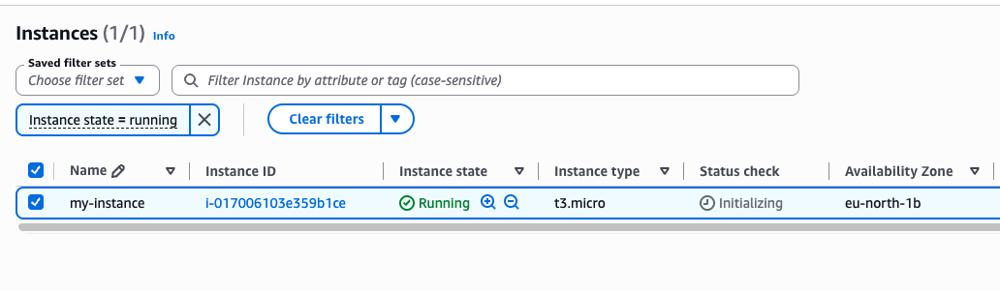
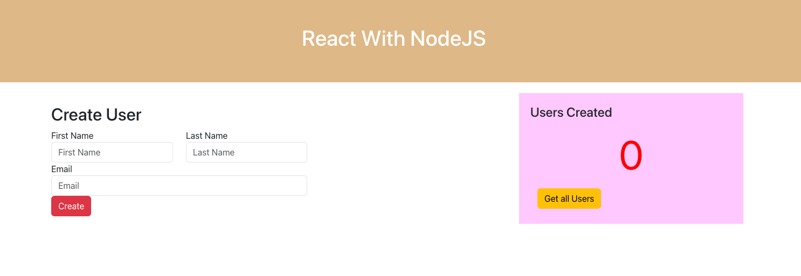

# Deploy Web Application on EC2 Instance (manually)

## Technologies used

AWS, Docker, Linux

## Project description

- Created and configured an EC2 instance on AWS
- Installed Docker on the remote EC2 instance
- Deployed a Docker image from a private Docker repository on the EC2 instance

## The application

A web application with a React frontend (`my-app/`) and a Node.js API (`api/`).
The multi-stage `Dockerfile` builds the React UI first, then packages it with the
Node.js server, which serves both the UI and the API on port `3080`.

The image is published to the private Docker Hub repository
`simonknudsen7/demo-app` for both `linux/amd64` and `linux/arm64`, so it runs on
the EC2 instance as well as on Apple Silicon.

## Steps

1. **Build and push the image** (from the project root):

   ```sh
   docker buildx build --platform linux/amd64,linux/arm64 \
     -t simonknudsen7/demo-app:1.0 -t simonknudsen7/demo-app:latest --push .
   ```

2. **Create and configure the EC2 instance** in the AWS console. In its security
   group, allow SSH (port 22) from your IP and inbound traffic on port `3080`.

3. **Install Docker on the instance** over SSH, start the Docker service, and
   allow your user to run Docker commands.

4. **Log in to Docker Hub on the instance**. This is required because the
   repository is private:

   ```sh
   docker login -u simonknudsen7
   ```

5. **Run the container**:

   ```sh
   docker run -d -p 3080:3080 simonknudsen7/demo-app:1.0
   ```

6. **Open the app** at `http://<ec2-public-ip>:3080`.

## Result



*The EC2 instance `my-instance` (t3.micro) running in the eu-north-1b availability zone (Stockholm).*



*The "React With NodeJS" app running in Docker on the EC2 instance, served on port 3080.*
